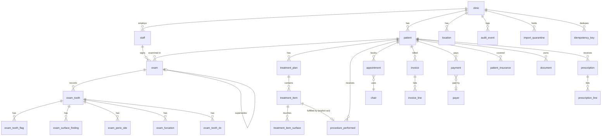

# Dontalist — Phase 1: Relational architecture proposal (Cloudflare D1)

Status: **PROPOSAL FOR REVIEW. Nothing in this document has been implemented.** No application code, IndexedDB structure, migration or existing clinical data was changed. The only artefact besides this file is `db/d1-sketch/0001_clinical_core.sql`, a design sketch that is applied nowhere (checked only by loading it into an in-memory SQLite and attempting the violations listed in §10).

Implementation (Phases 2–6) starts only after you approve, or amend, §17 (decisions) and §18 (risks).

Scope covered: your two briefs, "Master architecture rebuild" and "Critical addition: clinical data integrity and safe migration".

---

## 0. Things I am challenging before you review

1. **Tenant isolation without authentication is not isolation.** Composite FKs stop a *row* from pointing at another clinic's row. They do not stop a caller from naming another `clinic_id`. Today roles and PIN are frontend-only. D1 is reached through a Worker, so the Worker must derive `clinic_id` and `staff_id` from a verified session, never from the request body. **Authentication is therefore a prerequisite of Phase 2, not a later feature.** It is not in your six phases. Decision D1 below.
2. **The PostgreSQL work (migrations 0001–0003, `db/`, Neon) is superseded** by this direction: it uses JSONB, `numeric` money, text ids, RLS and exclusion constraints, none of which exist in D1. I propose to keep it in the repo as `db/postgres-superseded/` with a note, not delete it (you said never to remove functionality without approval). The Neon link and the exposed password rotation remain open.
3. **D1 has no interactive transactions and no RLS or exclusion constraints.** Atomicity is `db.batch([...])` (all statements succeed or all roll back) with guard statements. Double-booking prevention must be redesigned (§9) rather than ported.
4. **Snowflake ids in a stateless Worker are the weakest part of the design** (worker-id leases, clock behaviour; see §7). At 10 clinics and ~100 visits a day collisions from a simpler scheme would be practically impossible, so FlaresID is justified by your requirement for sortable, non-guessable-but-ordered, 64-bit ids, not by scale. I specify it as asked; I flag the cost.
5. **"No JSON anywhere" versus preserving raw source.** The recovery rules require keeping the original malformed payload byte-for-byte. I propose raw originals go to **R2 (with sha256 in a relational row)**, never into a business table. If you would rather keep them in D1 as an opaque TEXT blob in a quarantine table only, say so (D5).
6. **Initial bundle** is already over budget (543 kB vs 520 kB). Moving to a server does not fix that and is out of scope here.
7. Reference to the Open Dental data dictionary you linked returns 404. Table and column names in §3 are what I know of the Open Dental schema (versions 23–26) and **must be verified against a real dictionary or database before Phase 2 relies on them**. I mark each one unverified.

---

## 1. Existing architecture and persistence inventory (as audited)

**Persistence.** `ClinicDatabase` (IndexedDB `dental-clinic`) with stores: `locations`, `dentists`, `chairs`, `patients`, `appointments`, `documents`, `settings`, `auditEvents` (declared, unused). No server. `DentalStore` (root-provided) holds all state in signals and writes whole records.

**Nested structures inside one `Patient` record** (the thing that must not be copied into SQL):

| Frontend field | Shape | Problem for a database |
|---|---|---|
| `Patient.odontogram` | `unknown`; engine payload v2.22 `{version, globals, teeth{FDI→~80-field record}, plan?, case?}` | one document holds findings, plan and display flags; validated on read, defaults on failure |
| `Patient.examinations[]` | frozen copies of the same payload, one per visit | dated snapshots are good; stored as blobs, not queryable by tooth or finding |
| `Patient.plan[]` | `TreatmentItem[]` with status and fee | planned and done are one list, one status field |
| `Patient.payments[]`, `invoices[]` | arrays inside the patient | money as float, currency optional on legacy rows |
| `Patient.visits[]`, `messages[]`, `letters[]`, `proposals[]`, `insurances[]` | arrays | each independently edited, all rewritten with the patient |

Other stores: `appointments` (top-level, good), `documents` (bytes in IndexedDB), `settings` (key/value including `insuranceProviders`, regional, payers).

**Chart engine** (`odontogram/engine`): `chart.ts` (read/validate/write), `exam.ts` (snapshots), `edits.ts` (rules per edit kind), `vendor/state/payload.ts` (`defaultState`, `hydrateState`, `serializeState`, VALID_* sets). Tooth key is always **FDI**; Universal and Palmer are display only; primary teeth keep their permanent *position* and are labelled 51–85 on screen.

**Tooth record contents (from `defaultState()`).** ~45 single-valued fields (enums and booleans), 6 per-tooth `Set`s/`Map`s keyed by surface, a 6-site perio sub-record, furcation by entrance, 4-surface plaque and graded indices, one scalar (`kg`), a `customStates` object and a free note.

---

## 2. Entity-relationship analysis of the current model

- A **patient** owns everything by array membership; nothing outside the patient can reference a visit, a payment or a plan item.
- **Examination** → one frozen chart. The *current* chart (`Patient.odontogram`) is not an examination; it is the live working copy. So "initial", "current" and "history" are not distinguished in the data, only by convention.
- **Plan** is also embedded twice: `chart.plan` (planned tooth state) and `Patient.plan[]` (priced items). They can disagree.
- **Payments** reference nothing but the patient; invoices freeze lines (good).
- **Insurance** is a patient array pointing at a catalogue by string id.
- Nothing carries `createdBy`/`updatedBy`; `auditEvents` is empty.

---

## 3. Open Dental comparison

Open Dental stores one row per fact. Tooth numbers are strings in **Universal** notation ("1"–"32", "A"–"T") with the display convention switchable. Surfaces are a letter string on the procedure row. **Names below are from my knowledge of the schema and are unverified (D6).**

| Clinical area | Open Dental implementation | Dontalist proposal | Reason |
|---|---|---|---|
| Tooth identification | `procedurelog.ToothNum` and `toothinitial.ToothNum`, varchar, Universal ("1"–"32", "A"–"T") | `tooth_fdi` INTEGER 11–48 with a CHECK; deciduous recorded by `tooth_state = milktooth`, not by a different number | FDI is already our storage key; one number per position keeps primary/permanent history on one axis |
| Numbering | Display system is a preference; stored value is Universal | Same idea: display only (FDI / Universal / Palmer already exist in `numbering.ts`) | no migration of meaning, no ambiguity |
| Surfaces | `procedurelog.Surf` letter string (M O D B/F L/I V) on the procedure; `Surf` also stores range for quadrants/arches via `ToothRange` | `code_surface` catalogue + one row per surface in `exam_surface_finding`; a treatment item uses a `treatment_item_surface` child table | normalized, queryable, FK-checked; avoids parsing strings |
| Conditions | existing conditions are `procedurelog` rows with `ProcStatus = 'EC' (existing current)` / `EO` (existing other) | `exam_tooth` + `exam_surface_finding` + `exam_tooth_flag` for *findings*; `procedure_performed` only for work done | OD mixes finding and work in one table; our engine already separates them, keep the separation |
| Initial chart state | `toothinitial` (`InitialType`: missing, hidden, primary, drawing…), one row per exception | the **initial examination** (`exam.kind = 'initial'`), immutable once signed, with a partial unique index "one non-voided initial per patient" | gives a real baseline instead of exceptions, and keeps "missing" explicit |
| Diagnoses | optional `diseasedef`/`disease` for problems; no tooth-level dx by default | `exam_tooth_dx` (suggested vs confirmed vs suppressed, ICD-10 code FK) | engine already derives *suggested* diagnoses; confirmation must be a clinician act, stored |
| Procedures | `procedurelog` + `procedurecode` (`CodeNum`, `ProcCode`, `Descript`, `TreatArea`) | `procedure_code` catalogue per clinic + `treatment_item` (planned) + `procedure_performed` (done) | planned never becomes completed by an UPDATE (§11, test 7) |
| Procedure history | `procedurelog.ProcStatus` TP / C / EC / EO / R / D / Cn, `ProcDate`, `DateTP` | status CHECK per table; `voided` rows kept with a reason; `supersedes_id` for corrections | OD overwrites the status on one row; we keep history |
| Perio exams | `perioexam` (`PerioExamNum`, `PatNum`, `ExamDate`, `ProvNum`) | `exam` with `kind = 'perio'` (same table; one examination concept) | one signing, audit and concurrency model |
| Perio measurements | `periomeasure` one row per *tooth × measure type* with six columns `MBvalue, Bvalue, DBvalue, MLvalue, Lvalue, DLvalue` | `exam_perio_site`: one row per tooth × site (MB, B, DB, ML, L, DL) with `probing_mm`, `margin_mm`, `bleeding`, `suppuration`; **CAL derived** | sites are independently addressable; absence means *not charted* (engine convention), which six nullable columns blur |
| Treatment planning | `treatplan`, `proctp` (saved plans), `procedurelog` rows with `ProcStatus = TP`, priority via `definition` | `treatment_plan` header (versioned, accepted/declined) + `treatment_item` lines | acceptance and version history are first-class |
| Value lists | `definition` table (category + item) | typed `code_*` tables with FKs | OD's generic `definition` loses FK safety; we want the database to reject unknown values |

Deliberate departures: no free-text surface strings; no single generic definition table; findings and work separated.

---

## 4. Odontogram: visual representation versus anatomical meaning

What the user sees is a drawing (3D tooth, crown top, surface cube). What must be stored is the clinical statement, never the drawing.

| Visual element | Anatomical / clinical meaning | Stored as |
|---|---|---|
| Tooth tile, FDI label (any numbering) | a tooth position | `tooth_fdi` |
| Tooth silhouette variants (base, milk, implant, under-gum, none) | presence state | `exam_tooth.tooth_state` (FK catalogue) |
| Five-face cube (buccal, mesial, occlusal, distal, lingual) | caries, filling, defects, radiographic depth per surface | `exam_surface_finding(kind, surface, value_code)` |
| Four-face plaque grid | plaque, Silness-Löe, Löe-Silness, Mombelli per surface | same table, other `kind` values |
| Six probing sites | perio depth, margin, bleeding, suppuration | `exam_perio_site` |
| Furcation arrows | entrance + Glickman grade 1–4 | `exam_furcation(entrance, grade)` |
| Colour overlays, pulp tint | rendering of `pulp_dx`, `apical_dx`, endo | not stored; derived |
| Planned versus status tint | plan differs from finding | derived from `treatment_item` vs findings |

**Risk found:** surface geometry is not one thing. Caries and fillings use 5 surfaces, plaque/PI/GI 4, perio 6 sites, furcation per entrance. They must **not** share one surface code table. `code_surface` covers the 5 anatomical surfaces; plaque indexes use a constrained subset (CHECK); perio sites and furcation entrances have their own CHECKs.

## 5. Surface serialization analysis

Today: `Set<string>` and `Map<surface, value>` serialised to arrays/objects inside the tooth record; "absent means not charted, never zero". The relational form preserves exactly that: **a row exists iff the clinician charted it**. Grade 0 is never stored (indexes), 0 mm is a valid probing depth and distinct from no row.

## 6. Periodontal model analysis

- Exactly **six sites** per tooth, fixed: MB, B, DB, ML, L, DL. CHECK on `site`.
- `probing_mm` 0–20; `margin_mm` −10…+20 signed (positive = recession); **CAL = probing + margin is never stored** (view or query).
- Bleeding and suppuration are flags tied to a charted site (a row), so "bleeding on a site never probed" is impossible by construction.
- Perio exam = `exam.kind = 'perio'`. Comparison between exams (existing `comparePerioExams`) works on queries of two exam ids.
- Mobility is a tooth-level finding (`exam_tooth.mobility`), not a perio site.

**Exactly two charts** are preserved: odontogram and periodontogram both read the same `exam` family; no third chart is introduced.

---

## 7. FlaresID specification

| Property | Value |
|---|---|
| Size | 63 usable bits (sign bit 0), so it fits a signed 64-bit integer |
| Layout (MSB→LSB) | 1 bit 0 · **41 bits** milliseconds since epoch · **10 bits** worker · **12 bits** sequence |
| Epoch | 2026-01-01T00:00:00Z (fixed constant, versioned) |
| Capacity | 4096 ids per ms per worker, 1024 workers, ~69.7 years from epoch (to 2095) |
| JS type | `BigInt` in code. **Never `number`** (exceeds 2^53) |
| Storage | `TEXT`, **19-digit zero-padded decimal** (`0123456789012345678`). Zero-padding keeps lexical order equal to numeric order. `CHECK (length(id)=19)` |
| Why not INTEGER | D1 returns rows through JSON and JS numbers; ids above 2^53 would silently lose precision. This is a data-loss risk, so TEXT |
| Order | time-ordered per worker; globally roughly time-ordered |
| Worker id | leased from a `worker_lease` table (`worker_id`, `holder`, `expires_at`) at isolate start with a `UPDATE ... WHERE expires_at < now` claim; 1024 slots far exceed need. Fallback: refuse to mint ids (never invent a UUID) |
| Sequence overflow | if 4096 in one ms, wait for next ms |
| Clock rollback | keep `lastTimestamp`; if `now < last`, **do not go backwards**: continue from `last` (sequence keeps counting) up to a tolerance of 5 s, then throw and alert. Never reuse a (ts, seq) pair |
| Isolate restarts | `lastTimestamp` is lost; a new isolate takes a new worker lease, so (worker, ts, seq) stays unique even on a rewound clock |
| Not an id for secrets | ordered, so guessable by neighbours; authorization never relies on id secrecy |
| Tests | monotonic in a burst; 4096-overflow waits; rollback path; round-trip BigInt↔TEXT; ordering of padded strings; two workers never collide |

The shell id format for legacy rows stays the existing string; migration maps them with `legacy_id` (§13).

---

## 8. Proposed ERD

## 9. Full table list

Every business table's primary key is **`(clinic_id, id)`**; every child FK includes `clinic_id`. Bold = in the sketch SQL.

**Tenancy & people:** **clinic**, location, **staff**, staff_session (auth, D1), chair, **patient**, patient_contact_duplicate_candidate.

**Clinical:** **exam**, **exam_tooth**, **exam_tooth_flag**, **exam_surface_finding**, **exam_perio_site**, exam_furcation, exam_tooth_dx, treatment_plan, **treatment_item**, treatment_item_surface, **procedure_performed**, visit_note, prescription, prescription_line, medication/allergy library tables (current `medication-allergy-library.md`), patient_allergy.

**Scheduling:** appointment, appointment_slot (see double booking), waitlist.

**Money:** invoice, invoice_line, payment, payer, patient_insurance, insurance_provider (reference), currency_rate_snapshot.

**Documents:** document (metadata) → R2 object key + sha256; letters, messages.

**Platform:** **audit_event**, **import_quarantine**, **idempotency_key**, migration_run, migration_item, worker_lease, setting (typed key/value, no JSON), **code_*** catalogues, analytics_* summary tables (§12).

**Double booking.** No exclusion constraints in D1. Proposal: one row per (clinic, chair, 15-minute slot) in `appointment_slot` with `UNIQUE (clinic_id, chair_id, slot_start)`; booking inserts all slots in one `batch()`, a collision fails the batch and nothing is booked. Provider double-booking uses the same table keyed by provider. This is portable to MySQL.

**Key constraints (excerpt, see sketch).** Composite FKs `(clinic_id, patient_id) → patient`; partial unique index "one non-voided initial exam per patient"; CHECK on FDI (11–48, units 1–8); CHECK on perio site, probing and margin ranges; `treatment_item.status` has no `completed`; `procedure_performed` `voided` requires a reason; `audit_event` triggers forbid UPDATE/DELETE; triggers freeze signed exams.

**Duplicate-patient detection without auto-merge.** Query-time candidates on `(clinic_id, phone_e164)` and `(clinic_id, birth_date, normalized_name)`; candidates land in `patient_duplicate_candidate`; a human merge records `merged_into_id` and keeps both rows (soft merge), never rewrites ids automatically.

**Idempotency.** `idempotency_key(clinic_id, scope, key, request_sha256, result_id)` for payments, invoices, appointments, prescriptions, imports. Same key + same hash returns the stored result; same key + different hash is a 409.

**Optimistic concurrency.** Every editable root has `row_version`. Update is `UPDATE ... SET row_version = row_version + 1 WHERE (clinic_id, id) = (?, ?) AND row_version = ?`; zero rows changed means a stale edit and the API returns the current version for the user to reconcile. A multi-row chart save checks the **exam** row version, inside the same `batch()`.

## 10. Indexing, constraint and sketch verification

Indexes follow the actual queries: patient search (name, phone, birth), patient timeline (`exam (clinic, patient, exam_date DESC)`), chart load (`exam_tooth` PK prefix), perio compare (PK prefix on exam), day agenda (`appointment (clinic, chair, start)`), outstanding balance (`invoice (clinic, patient, status)`), audit by entity. **EXPLAIN QUERY PLAN output for each is a Phase 3 deliverable;** none is claimed here.

The sketch was loaded into SQLite and these violations were attempted; all were rejected by the database, none by application code: exam pointing at a patient of another clinic; a second initial exam; tooth 19; updating `audit_event`; inserting a treatment item with status `completed`.

## 11. Clinical-integrity addendum

### 11.1 What is wrong today (verified in code)

| # | Location | Finding | Risk |
|---|---|---|---|
| R1 | `chart.ts readTeeth` | a tooth whose record is **not an object** gets `defaultState()` and an issue entry | corrupted tooth becomes a healthy natural tooth |
| R2 | `chart.ts readTeeth` | a tooth that is **absent** from the payload also gets `defaultState()` and **no issue** | "unrecorded" and "healthy natural tooth" are the same value |
| R3 | `chart.ts readTeeth` | unrecognised enum strings are reported, then **overwritten** by the default (`hydrateState`) | clinical value lost; reported but not preserved |
| R4 | `chart.ts readTeeth` | unknown tooth keys are reported then dropped; `customStates` is the only open-ended slot | unknown clinical fields are discarded |
| R5 | `chart.ts readChart` | returns `chart` with `issues` and callers may continue to edit and save | next save overwrites the original with the repaired copy |
| R6 | `chart.ts readChart` | invalid `globals` fall back silently to defaults (reported) | display flags only, low clinical risk |
| R7 | `edits.ts` `selection` | builds `defaultState()` and `Object.assign`s it over the tooth; only some fields are re-applied | caries, restorations, perio, mobility, notes erased with one dropdown change; not confirmed, no history |
| R8 | `exam.ts makeExamination` | snapshots the current chart including any repaired values | a repaired (not real) value becomes frozen history |
| R9 | `readChart` returns `null` for non-object payload | good: the caller must handle. Callers must be checked so null never becomes `newChart()` | to verify in Phase 2: every caller |

### 11.2 Required behaviour (design)

1. **Three states per tooth**, not two: *unrecorded* (no row), *recorded* (row), *unreadable* (quarantined; tooth locked). Unrecorded renders neutral/grey with "not recorded"; it is never exported as healthy.
2. **Reading is lossless or refuses.** `readChart` returns `{status: 'ok' | 'needs_review', teeth: perTooth {state, record?, raw?}, unknown: field list}`. `needs_review` means any R1–R4 situation.
3. **A chart in `needs_review` is read-only.** Edit and save controls disabled; the API rejects writes with `409 chart_needs_review` regardless of the UI. The database also refuses: `exam.status` cannot move to `signed` while `import_quarantine` has an unresolved row for it (trigger).
4. **Raw preserved before any transformation**: original bytes to R2, sha256 and key in `import_quarantine`.
5. **Explicit recovery screen**: lists, per tooth, what could not be read, the raw value, what the engine would do, and **options: keep as unrecorded, enter manually, restore from an earlier examination**. Each choice is a recorded, attributed action (`audit_event`). Nothing is auto-resolved to "healthy".
6. **Unknown fields**: a field the engine does not recognise is either kept in a typed `exam_tooth_unknown(field, raw_text)` table pending review or blocks the migration item as *ambiguous*. Never silently dropped.
7. Same rules apply to JSON import, backup restore, migration and API reads; the same function enforces them.

### 11.3 Tooth transition rules (replaces the reset in `selection`)

Transition is a pure function `planTransition(from, to, record) → {keep[], convert[], conflicts[], needsConfirm}`; applying it is a second step after confirmation; both steps are recorded.

| From → To | Keep | Conflicts (listed, need confirm) | Notes |
|---|---|---|---|
| natural → implant | note, mobility, perio probing (becomes peri-implant), plaque indexes, extraction history | caries, natural-tooth fillings, endo, pulp/apical dx, crown on natural substrate, root findings | prior values stay in history; implant-only axes (`periImplant`, `mpi`, `mbi`) become available |
| natural → missing / extracted | note, history, `extractionWound` | everything surface- and pulp-related, perio sites, mobility | requires confirmation; extraction becomes a *recorded event*, not just a state |
| missing → present (natural) | note | none from the old record (nothing to conflict) | creates a **new** recorded tooth; old missing state kept in history; asks whether this is an eruption, a correction of a charting error, or a re-implant |
| permanent → deciduous | note, caries, fillings, perio | only allowed where a deciduous predecessor exists (existing `MILKTOOTH_BLOCKED`: all molars 16–18 etc. blocked); crown/implant conflict | anatomy check is data (code table), not code |
| any → unerupted / under-gum | note | caries, fillings, perio sites, mobility, restorations | pulp/apical dx keep only with radiograph flag |
| implant → natural | note | implant-only axes, prosthesis | clinically unusual; always confirm and name the reason |
| restored natural with endo → crownprep | endo, pulp dx, restoration | none | compatible; no confirmation |

Anything not in the table is *rejected*, not guessed. "Clinically impossible combinations" are enforced by a validation function shared by UI, API and the migration (the current `isValidRestoration` stays the single source for restoration combos).

### 11.4 Clinical history and audit

- **Exams** are dated snapshots. Signing freezes them (trigger). Correction creates a new exam with `supersedes_id`; the old one becomes `superseded`, not deleted.
- **Current state** = findings of the latest signed exam + the open draft, **not** a separate mutable copy. This removes the "working odontogram vs examinations" duplication and makes "history unchanged after edits" structurally true (test 6).
- **Initial vs current vs planned vs done** = initial exam / latest exam / `treatment_item` / `procedure_performed`.
- `created_by`, `created_at`, `updated_by`, `updated_at`, `row_version` on every editable root; `audit_event` rows (before/after as text) in the **same `batch()`** as the change, append-only by trigger.
- Voided and superseded rows are never physically deleted by application paths; deletion is a separate privileged retention job.

### 11.5 Migration strategy (IndexedDB → D1)

1. **Audit** every historical shape: payload versions (`isLegacyPayloadVersion`, migrated fields `crownMaterial`, `bridgeUnit`, `cariesSeverity`, `secondaryCaries`), legacy payments with no currency (counted as MAD), legacy plan items with no currency, examinations created before `examiner`.
2. **Extract-only first**: a read-only exporter produces a backup file plus sha256; the user keeps it. Original IndexedDB is **not modified or deleted** by migration.
3. **Dry run** produces the report (below) with zero writes to D1.
4. **Load** in per-patient `batch()` units; each patient is all-or-nothing.
5. **Idempotent**: `(clinic_id, source_system, source_key)` unique; deterministic mapping from a legacy id to a stored `legacy_id`; a re-run updates nothing that exists and reports `skipped_existing`.
6. **Failure leaves the original recoverable**: nothing destructive, raw payload preserved in R2 for every rejected/ambiguous item.
7. **Report** (human readable, per patient and per tooth): `converted`, `rejected`, `ambiguous`, `recovered`, with reasons. A migration is "done" only when `ambiguous = 0` or each one is explicitly resolved by a person.
8. **Verification**: after load, regenerate the engine payload from the relational rows and compare clinical meaning per field with the source (round-trip test).

**Current-to-new mapping (summary).**

| Current | New |
|---|---|
| `Patient.odontogram` (working chart) | draft `exam` (kind `working`) for the patient |
| `Patient.examinations[]` | one `exam` each, status `signed`, `examiner` mapped from the free-text name to `staff` or flagged *ambiguous* |
| tooth record scalar enums | `exam_tooth` typed columns (FK-checked codes) |
| 23 boolean flags and `mods` | `exam_tooth_flag` rows |
| `caries`, `cariesSeverity`, `fillingSurfaces/Materials`, `fillingDefect`, `radiographicDepth`, plaque, `pi/gi/mpi/mbi` | `exam_surface_finding` rows by `kind` |
| `perio.pd/gm/bop/sup` | `exam_perio_site`; `bop`/`sup` without `pd` for that site → *ambiguous*, not dropped |
| `furcation` | `exam_furcation` |
| `dxOverrides` | `exam_tooth_dx` |
| `kg` | `exam_tooth.keratinized_mm` |
| `customStates`, unknown fields | `exam_tooth_unknown` pending review |
| `chart.plan` (planned tooth state) | **not migrated as findings**; informs a `treatment_plan` draft the clinician confirms (a plan is never inferred from status) |
| `Patient.plan[]` | `treatment_item`; items marked done → `procedure_performed` with `source = migration` and the original date; an item **without** a completion date and marked done → *ambiguous* |
| payments / invoices | `payment` / `invoice` + lines; amount × 100 to integer minor units with rounding rule reported; missing currency → MAD flagged `assumed` |
| documents (bytes) | R2 object + `document` row + sha256 |

## 12. Caching and analytics

- **Cache API / KV / Durable Objects are never authoritative.** Allowed: catalogues (`code_*`, insurers, procedure codes), country/city JSON, computed agenda for the day with short TTL. Never cached: charts, balances, anything that changes clinical or money state. A cache miss must always be correct; invalidation by `row_version` in the key.
- **Analytics**: derived tables `analytics_daily_clinic(clinic_id, day, visits, new_patients, billed_minor, collected_minor, currency)` and similar, written by a scheduled Worker (cron trigger) from source tables; a **reconciliation job** recomputes a window from sources and writes any mismatch to `analytics_discrepancy`. Reports read the summaries; if reconciliation fails, the report says so.
- **Money**: INTEGER minor units + ISO 4217 currency on every row, CHECK `length = 3`; no floats; conversion only through `currency_rate_snapshot` with the rate stored, never recomputed.

## 13. D1 → MySQL portability

Portable as designed: composite PK/FK, CHECK (MySQL 8.0.16+), TEXT ids (use `CHAR(19)`), INTEGER minor units, UNIQUE, ordinary indexes, `batch()` → transaction.

Needs a translation layer: partial unique indexes (MySQL has none; use a generated column or a unique key with a nullable guard), `RAISE(ABORT)` triggers (MySQL `SIGNAL`), `GLOB` in CHECK (use `REGEXP`), `datetime` as TEXT ISO strings (use `DATETIME(3)`), `PRAGMA foreign_keys`. These are listed in the sketch comments; the repository layer must not use SQLite-only functions outside a `dialect/` folder.

## 14. Documents and backup

Documents in **R2**, key `clinic/{clinic_id}/patient/{patient_id}/{document_id}`; D1 holds name, MIME, size, sha256, uploader, timestamps. Backup: D1 Time Travel (point-in-time) plus a scheduled full export to R2 with sha256; user-initiated JSON export remains (interchange only), and restore goes through the **same validation** as import.

## 15. Regression test plan (12 required)

| # | Test | Layer | Passing means |
|---|---|---|---|
| 1 | malformed tooth never becomes healthy | engine unit + migration | `readChart` returns `needs_review`, tooth state `unreadable`, no default record |
| 2 | invalid chart cannot be saved over the original | API + DB | write returns 409; trigger blocks signing; original row/raw intact |
| 3 | unknown fields preserved or reported | engine + migration | field present in `exam_tooth_unknown` or item `ambiguous`, never dropped |
| 4 | transitions preserve compatible findings | engine unit | per row of §11.3, `keep` fields unchanged after apply |
| 5 | destructive transitions require confirmation | engine + API | apply without confirmation token is rejected |
| 6 | history unchanged by current edits | DB | signed exam rows byte-identical after editing the draft; UPDATE on signed exam fails |
| 7 | planned never becomes completed automatically | DB + API | no path from `treatment_item` UPDATE to `procedure_performed`; CHECK has no `completed` |
| 8 | concurrent edits cannot overwrite | API/DB | second writer with a stale `row_version` gets 409, data unchanged |
| 9 | import/export, backup/restore keep meaning | round-trip | engine payload → relational → payload equal per field |
| 10 | failed migration leaves original recoverable | migration | injected failure mid-run; source untouched, report lists the failure, re-run completes |
| 11 | cross-patient and cross-clinic refs rejected | DB | FK failures (verified in the sketch for cross-clinic) |
| 12 | repeated migration does not duplicate | migration | row counts identical after a second run |

Existing 550 tests stay; the new ones are added, none removed.

## 16. Phases and what each would change

| Phase | Content | Destructive? |
|---|---|---|
| 1 | this proposal | no |
| 2 | auth + Worker skeleton, FlaresID, D1 migrations (empty database), repositories, no UI change | no (IndexedDB untouched) |
| 3 | clinical schema complete, indexes with real EXPLAIN QUERY PLAN, engine `readChart`/transition fixes with tests 1–5 | engine behaviour change, behind tests |
| 4 | migration tool (dry run → report → load), tests 9, 10, 12 | no (original kept) |
| 5 | frontend switches from `ClinicDatabase` to the API; cache; analytics | switches the source of truth |
| 6 | cutover rehearsal, rollback, retention, docs | only after explicit sign-off |

I would do the **engine-side safety fixes (11.2 items 1–3, 11.3) first, even before the database**, because they protect patients today in the app that exists. That is the one early change I recommend; I will not make it without your approval.

## 17. Decisions I need from you

| ID | Decision | My recommendation |
|---|---|---|
| D1 | Authentication for the Worker (Cloudflare Access, own email+password with sessions, or a provider) | own session auth in D1 for staff, PIN kept only as a local convenience |
| D2 | Examiner mapping: legacy `examiner` is free text | map to staff when exact match, otherwise *ambiguous* |
| D3 | Working chart as draft `exam` rather than a separate table | yes (§11.4) |
| D4 | Plan state (`chart.plan`) not migrated as findings | yes; clinician confirms |
| D5 | Raw payloads in R2 (recommended) or a TEXT quarantine blob in D1 | R2 |
| D6 | Verify Open Dental names against a dictionary or a real database | please attach the dictionary or confirm version |
| D7 | Keep or retire the PostgreSQL work | **Decided 2026-11-13: forget Neon.** Work moved to `db/postgres-superseded/`, `neon.ts` and `@neon/*` removed |
| D8 | Engine safety fixes now (before Phase 2)? | **Done 2026-11-13** ("continue the work"): damaged-chart lock with recovery, tooth-type change confirmation, tests in `engine/integrity.spec.ts` |
| D9 | Whether `exam_tooth` should keep ~10 typed columns or be fully surface/condition rows | typed core + rows for the repeating parts (this document) |
| D10 | Moroccan insurer list confirmation (MCAP, MUCAP, FAR) | you review |
| D11 | Is offline use a requirement? (clinics working through an internet outage) | decide before Phase 2; it changes the whole sync design |

## 18. Risk assessment

| Risk | Impact | Mitigation |
|---|---|---|
| Server added to an app that was offline-only | clinics lose offline use | decide whether offline is a requirement (D11, not yet asked); queue + sync is a large separate piece |
| Auth absent | tenant isolation is nominal | D1, Phase 2 gate |
| FlaresID worker/clock handling | duplicate ids | lease table, rollback tolerance, tests (§7) |
| D1 limits (10 GB per database, no interactive transactions, bound-parameter cap) | large batches fail | per-patient batches, chunking; one database per clinic is an alternative if size grows |
| Open Dental names unverified | wrong comparison | D6 |
| Migration of ambiguous legacy data | some records need a human | report-driven, nothing auto-resolved |
| Over-normalising | slow development | typed core plus row tables only where independently edited |
| Engine fixes change visible behaviour (read-only charts) | clinicians blocked by a corrupted tooth | explicit recovery screen, restore from earlier exam |
| Bundle size | slower first load | unrelated; tracked |

## 19. Deployment honesty

This sandbox cannot reach Neon or Cloudflare, and no Cloudflare project, D1 database, R2 bucket or Worker exists. The app today still runs on IndexedDB. **"Deploy" is not achievable from this work, and deploying the current IndexedDB build is a separate action you can run.** I did not build or publish anything in this phase.
